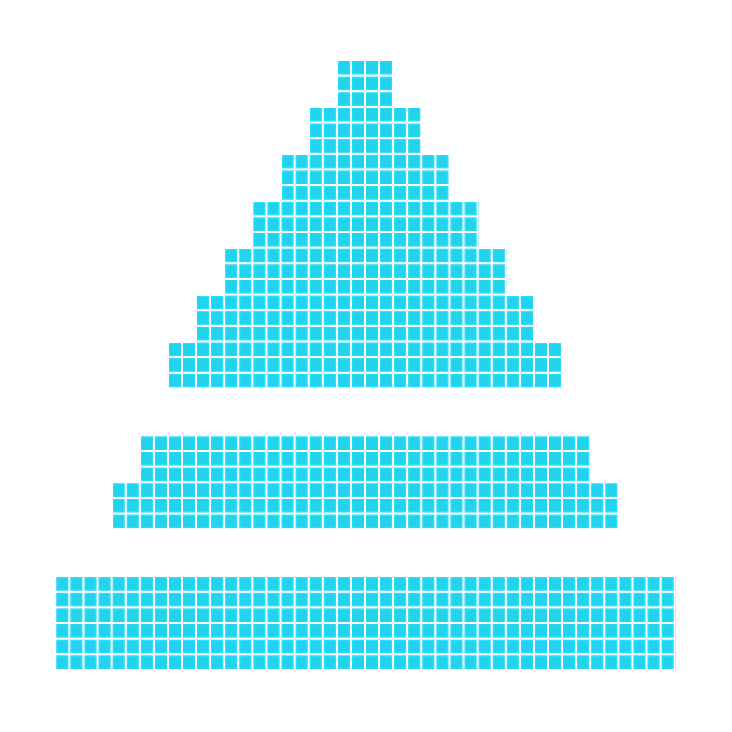

<p align="center">
    
</p>

<h1 align="center">Piramid</h1>

Piramid is written in Rust and combines an LLM inference runtime with a vector database.

The runtime executes supported language-model checkpoints, manages generation and the KV cache,
and serves requests over HTTP. The database stores documents, embeddings, and metadata in durable
collections with exact vector search and metadata filtering. Collections remain searchable with
no generation model loaded.

## Status and direction

- **Implemented:** persistent collections, exact vector search on CPU or CUDA, embedding providers,
  and generation with supported Qwen2 and Qwen3 checkpoints through Candle.
- **Systems work:** profiling, GPU memory use, KV-cache management, batching, scheduling, and
  execution overhead, measured on stated workloads.
- **Experimental direction:** retrieving and integrating information during generation. The
  forward-pass hook exists, but its current implementation is a no-op; retrieval for generation
  currently happens before prefill. See [the roadmap](docs/ROADMAP.md).

Piramid runs existing compatible checkpoints. It does not require a project-specific model.
Support for another architecture belongs in an execution backend; model training is only relevant
to an experiment when the mechanism being tested requires it.

## Quickstart

```bash
curl -fsSL https://piramiddb.com/install.sh | sh     # prebuilt, CPU
cargo install piramid --locked --features inference-candle,gpu-cuda  # or build, with CUDA

hf download Qwen/Qwen2.5-0.5B-Instruct --local-dir ./models/Qwen2.5-0.5B-Instruct
```

`piramid.yaml`:

```yaml
startup:
  hardware:
    profile: gpu
  embedding:
    provider: openai
    model: text-embedding-3-small

runtime:
  execution: gpu
  inference:
    enabled: true
    model_path: ./models/Qwen2.5-0.5B-Instruct
```

```bash
export OPENAI_API_KEY=...
piramid serve --config piramid.yaml          # 127.0.0.1:6333

curl -X POST localhost:6333/api/collections/docs/embed -H 'Content-Type: application/json' \
  -d '{"texts": ["Compaction rewrites the record store without deleted documents."]}'

curl -X POST localhost:6333/api/generate -H 'Content-Type: application/json' \
  -d '{"messages": [{"role": "user", "content": "What happens to deleted documents?"}],
       "retrieval": {"collection": "docs", "k": 2}}'
```

## Docs

| | |
|---|---|
| [User docs](apps/website/content/docs/) | install, configuration, providers, HTTP API, console; served at [piramiddb.com/docs](https://piramiddb.com/docs) |
| [docs/ARCHITECTURE.md](docs/ARCHITECTURE.md) | crates, seams, request flows, KV cache, durability |
| [docs/ROADMAP.md](docs/ROADMAP.md) | direction, milestones, what is out of scope |
| [docs/SETUP.md](docs/SETUP.md) | contributor setup, tests, benchmarks, PR rules |
| [docs/decisions/](docs/decisions/) | why the shape is what it is |
| [apps/sdk/python](apps/sdk/python) | the Python client, `pip install piramid` |
| [AGENTS.md](AGENTS.md) | layout, dependency rule, conventions |
| [config.example.yaml](config.example.yaml) | every setting at its default |

## Development

```bash
just bootstrap   # .env, git hooks, dependencies
just check       # the gate: fmt, clippy, tests, layering, website
just cli         # the console, plus a units view over the repo
```

## License

Proprietary. All rights reserved; see [LICENSE](LICENSE).

